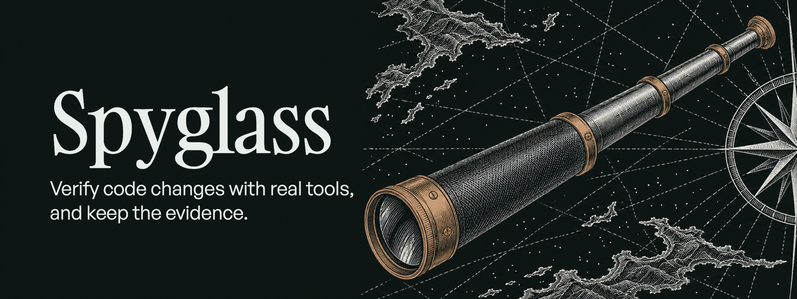
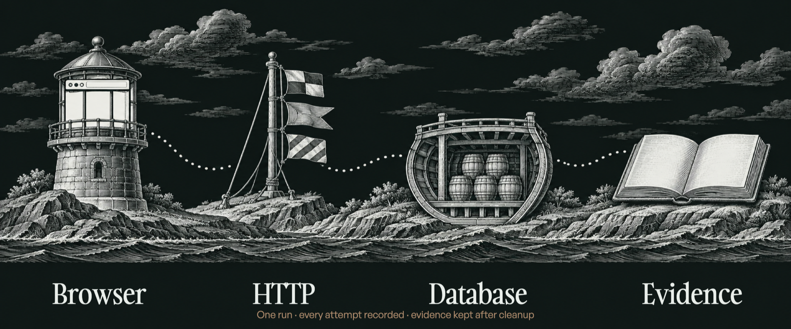

<h1 align="center">
  
</h1>

<p align="center">
  <a href="https://github.com/Schramm2/spyglass/actions/workflows/ci.yml"></a>
  <a href="https://www.npmjs.com/package/@mattschramm/spyglass"></a>
  <a href="LICENSE"></a>
  
</p>

<p align="center"><strong>Verify code changes with real tools. Keep the proof.</strong></p>

Spyglass is a command-line tool for coding agents and the people who review
their work. It connects browser actions, HTTP calls, database reads and
repository checks to one **run**. Each run records its source identity, every
attempt (failed attempts too) and its artifacts. The evidence stays after
cleanup, so another agent or person can inspect the result later without the
original chat or shell.

<p align="center">
  
</p>

## Why Spyglass

An agent can say "the tests pass" or "the page works". That statement is not
proof. Spyglass makes each verification step a recorded fact:

- **Real tools, no mocks.** Spyglass drives a real browser, real HTTP requests,
  a real PostgreSQL database and the repository's own checks.
- **Evidence that stays.** Screenshots, responses, query rows and logs go to a
  Git-ignored evidence folder with checksums. Cleanup does not remove them.
- **Honest results.** Failed attempts stay in the record. A report stays
  incomplete until each claim has a completed step and its evidence.
- **Source identity.** Each run records the commit and working-tree state.
  Evidence from source that changed after the run started cannot pass as
  proof for the original source.
- **Safe by default.** The browser opens only the configured origins. Database
  queries run in a read-only transaction. Reports mask credentials, cookies and
  authorization headers.
- **Built for agents.** Each command gives a versioned JSON result with
  `--json`, uses stable exit codes and never prompts.

Spyglass does not decide whether a claim covers the request, or whether a
screenshot looks correct. The **operator** (the agent or person) selects the
claims and judges the results. Spyglass makes sure that the cited steps
completed, the artifacts exist, the source is current and the cleanup is done.

## Install

The package is `@mattschramm/spyglass`; the command is `spyglass`. It needs
Node.js 24 or later and Git.

```sh
npm install --global @mattschramm/spyglass
spyglass --version
```

For a fixed version without a global installation:

```sh
npm exec --yes --package=@mattschramm/spyglass@VERSION -- spyglass --version
```

Replace `VERSION` with a published version. Do not use `npm install spyglass`
or `npx spyglass`: the unscoped name is a different package. For an isolated
prefix, a source checkout, upgrades and rollback, see
[install and keep a version](https://github.com/Schramm2/spyglass/blob/main/docs/adoption.md#install-and-keep-a-version).

## Quick start

Run the [terminal quickstart](https://github.com/Schramm2/spyglass/blob/main/docs/quickstart.md) to try the workflow against a
local demo app. It takes approximately five minutes, records a deliberate
failure and a passing check, and keeps the report after cleanup. It uses no
paid services.

In your own repository, the workflow is:

```sh
spyglass init                                   # write spyglass.json; review it
spyglass up --run my-change --plan verification-plan.json --json
spyglass check verify --run my-change --claim CLAIM_ID --json
spyglass result set --run my-change --claim CLAIM_ID --outcome passed --observed "WHAT YOU SAW"
spyglass finish --run my-change --json          # result, doctor, down and report
```

Add `.spyglass/` to your `.gitignore`. It holds the evidence folder. Read
[run a verification](https://github.com/Schramm2/spyglass/blob/main/docs/usage.md) for the full lifecycle, and the
[adoption recipes](https://github.com/Schramm2/spyglass/blob/main/docs/adoption.md) for an existing suite, an isolated web app
or a repository-owned target.

## Documentation

| Guide                             | Contents                                                       |
| --------------------------------- | -------------------------------------------------------------- |
| [Terminal quickstart][quickstart] | Try the workflow on a disposable demo app.                     |
| [Adoption recipes][adoption]      | Install, plan and verify a real repository.                    |
| [Run a verification][usage]       | Start, prove, record, finish and review a run.                 |
| [Command reference][commands]     | Surfaces, flags and recorded evidence.                         |
| [Configuration][configuration]    | Profile, lifecycle modes, bindings, credentials and seats.     |
| [Agent skills][skills]            | Skills that teach an agent to run and maintain a verification. |
| [Review proof in CI][ci]          | Retain and review reports in GitHub Actions.                   |
| [Failure cases][failures]         | Failures that the CLI must detect.                             |
| [Support][support]                | Tested platforms and tool versions, and setup diagnosis.       |
| [Limitations][limitations]        | What a successful run does not prove.                          |
| [Roadmap][roadmap]                | Priorities, completion checks and the next development task.   |
| [npm publication][publication]    | Maintainer procedure for a registry release.                   |

[quickstart]: https://github.com/Schramm2/spyglass/blob/main/docs/quickstart.md
[adoption]: https://github.com/Schramm2/spyglass/blob/main/docs/adoption.md
[usage]: https://github.com/Schramm2/spyglass/blob/main/docs/usage.md
[commands]: https://github.com/Schramm2/spyglass/blob/main/docs/commands.md
[configuration]: https://github.com/Schramm2/spyglass/blob/main/docs/configuration.md
[skills]: https://github.com/Schramm2/spyglass/blob/main/docs/agent-skills.md
[ci]: https://github.com/Schramm2/spyglass/blob/main/docs/ci.md
[failures]: https://github.com/Schramm2/spyglass/blob/main/docs/failure-cases.md
[support]: https://github.com/Schramm2/spyglass/blob/main/docs/support.md
[limitations]: https://github.com/Schramm2/spyglass/blob/main/docs/limitations.md
[roadmap]: https://github.com/Schramm2/spyglass/blob/main/docs/roadmap.md
[publication]: https://github.com/Schramm2/spyglass/blob/main/docs/npm-publication.md

Run `spyglass --help` for all commands, and `spyglass COMMAND --help` for one
command.

## Requirements

- Node.js 24 or later, and Git.
- [`agent-browser`](https://www.npmjs.com/package/agent-browser) 0.38.2 and its
  Chromium for browser checks, Docker Compose for container status and logs,
  and a PostgreSQL database for database reads.
- No secret tool is necessary unless the profile uses `op://` references.

Spyglass does not install tools, fetch secrets or start your app during `init`.
See [platform and external-tool support](https://github.com/Schramm2/spyglass/blob/main/docs/support.md) for tested
configurations and unverified platforms.

## Development

```sh
npm ci
npm run build
npm test                          # end-to-end tests of the built CLI
SPYGLASS_TEST_SURFACES=1 npm test # also real Chromium and PostgreSQL in Docker
npm run format:check
```

The end-to-end tests run the built CLI in temporary Git repositories. They need
`agent-browser` on your `PATH`; the surface tests also need its Chromium and
Docker. Development uses Git Flow: `dev` is the default integration branch, and
`main` receives releases and urgent hotfixes. See
[CONTRIBUTING.md](https://github.com/Schramm2/spyglass/blob/main/CONTRIBUTING.md) for setup, checks and the pull request
process, and [agent_docs/ci.md](https://github.com/Schramm2/spyglass/blob/main/agent_docs/ci.md) for the CI evidence boundary.

## Contributing

Contributions are welcome. Read [CONTRIBUTING.md](https://github.com/Schramm2/spyglass/blob/main/CONTRIBUTING.md) before you
open a pull request. This project follows a
[code of conduct](https://github.com/Schramm2/spyglass/blob/main/CODE_OF_CONDUCT.md).

To report a security vulnerability, follow [SECURITY.md](https://github.com/Schramm2/spyglass/blob/main/SECURITY.md). Do not
open a public issue.

## License

[MIT](https://github.com/Schramm2/spyglass/blob/main/LICENSE) © 2026 Matthew Schramm

The `create-verification-skill` and `maintain-verification-skill` skills are
adapted from [`cursor/plugins`](https://github.com/cursor/plugins)
(`pstack/skills`, commit `1dcc2ba`) by Lauren Tan, under the MIT license. Each
skill keeps its original `LICENSE` file.
