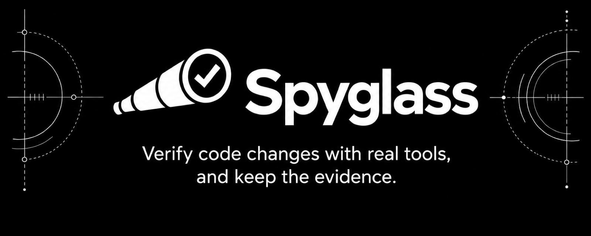
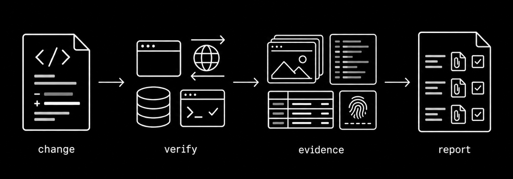

<h1 align="center">
  
</h1>

<p align="center">
  <a href="https://github.com/Schramm2/spyglass/actions/workflows/ci.yml"></a>
  <a href="LICENSE"></a>
  
</p>

Spyglass is a command-line tool for coding agents and the people who review
their work. It connects browser actions, HTTP calls, database reads and
repository checks to one **run**. Each run records its source identity, every
attempt (failed attempts too) and its artifacts. The evidence stays after
cleanup, so another agent or person can inspect the result later without the
original chat or shell.

<p align="center">
  
</p>

> [!NOTE]
> Spyglass 1.0.0 uses version 1 profile, plan and result schemas.

## Why Spyglass

An agent can say "the tests pass" or "the page works". That statement is not
proof. Spyglass makes each verification step a recorded fact:

- **Real tools, no mocks.** Spyglass drives a real browser, real HTTP requests,
  a real PostgreSQL database and the repository's own checks.
- **Evidence that stays.** Screenshots, responses, query rows and logs go to a
  Git-ignored evidence folder with checksums. Cleanup does not remove them.
- **Honest results.** Failed attempts stay in the record. A report stays
  incomplete until each claim has a completed step and its evidence.
- **Source identity.** Each run records the commit and working-tree state.
  Evidence from source that changed after the run started cannot pass as
  proof for the original source.
- **Safe by default.** The browser can open only the configured origins.
  Database queries run in a read-only transaction. Reports mask credentials,
  cookies and authorization headers.
- **Built for agents.** Each command gives a versioned JSON result with
  `--json`, uses stable exit codes and never prompts.

Spyglass does not decide whether a claim covers the request, or whether a
screenshot looks correct. The **operator** (the agent or person) selects the
claims and judges the results. Spyglass makes sure that the cited steps
completed, the artifacts exist, the source is current and the cleanup is done.

## Requirements

- [Node.js](https://nodejs.org/) 24 or later
- Git

These tools are necessary only for some surfaces:

| Tool | Necessary for |
| --- | --- |
| [`agent-browser`](https://www.npmjs.com/package/agent-browser) 0.38.2 | `up` for a profile with a `web` origin. Browser checks (`ui`) also need its Chromium. |
| Docker Compose | Container status and logs (`ps`, `logs`) |
| A PostgreSQL database | Database reads (`db`). The driver is included. |

Spyglass does not install tools, fetch secrets or start your app during `init`.

## Installation

Spyglass is not on npm yet. Install it from source:

```sh
git clone --branch v1.0.0 https://github.com/Schramm2/spyglass.git
cd spyglass
npm ci
npm run build
npm link
spyglass --version
```

## Quick start

The [terminal quickstart](docs/quickstart.md) runs a local demo app. It records
a deliberate failure and a passing check, and keeps the report after cleanup.
It takes approximately five minutes and uses no paid services.

In your own repository, the workflow is:

```sh
spyglass init                                   # write spyglass.json; review it
spyglass up --run my-change --plan verification-plan.json --json
spyglass check verify --run my-change --json    # run a named check
spyglass result --run my-change --file PATH     # record claim results
spyglass doctor --run my-change --json
spyglass down --run my-change --json            # clean up owned resources
spyglass report --run my-change --json          # write the offline report
```

Add `.spyglass/` to your `.gitignore`. It holds the evidence folder.

`up --plan` writes a pending result file and prints its path. Put the step IDs,
artifact paths and observations from your checks into that file. Then record it
with `spyglass result`. If a check fails, keep the original expectation. Repair
the source and start a new run.

## Usage

### Surfaces

| Surface | Commands | Evidence |
| --- | --- | --- |
| Existing tests and journeys | `check NAME` | Exit status, assertions, declared artifacts |
| Other commands | `exec -- COMMAND ARGS` | Bounded stdout and stderr, real exit status |
| Web browser | `ui open /`, `ui snapshot`, `ui proof LABEL` | Isolated session, screenshot, DOM, errors and requests |
| HTTP | `api GET /path --expect 200` | Masked request and response; redirects are not followed |
| PostgreSQL | `db 'SELECT ...' --expect-rows 1` | One statement in a read-only transaction, with rows and role limits |
| Docker Compose | `ps`, `mark LABEL`, `logs SERVICE --since LABEL` | Project-scoped status and timestamped logs |
| Other evidence | `evidence add --step ID --file PATH` | Checked copy from a declared import root |

Run `spyglass --help` for all commands, and `spyglass COMMAND --help` for the
arguments of one command.

### Output and exit codes

Default output is compact, indented text for people. `--json` gives one versioned
result object on stdout and diagnostics on stderr. The two modes use the same
handler and the same exit code.

| Exit code | Meaning |
| --- | --- |
| `0` | Success |
| `1` | Failed verification |
| `2` | Incorrect input |
| `3` | Environment failure |

`--run ID` selects a run across shell calls. You can also set `SPYGLASS_RUN`;
`--run` has priority. `spyglass status --run ID` shows the handoff state of a
run. `completedChecks.childExitCode` is the child process exit code;
`completedChecks.spyglassExitCode` is the Spyglass command exit code. A child
can exit zero while Spyglass rejects failed assertions. The earlier `exitCode`
and `commandExitCode` fields remain as aliases.

A visual result can use `inspections`, with one entry per viewport. Each entry
has `viewport`, `expected`, `observed` and `artifact`; the artifact must be a
valid screenshot from a cited step. The earlier single `inspection` remains
supported. Control templates include `failedRun`, initially the current run;
replace it when the intended failure belongs to a retained earlier run.

## Configuration

`spyglass init` writes a **profile** (`spyglass.json`). It contains the tools,
commands, bindings and evidence rules for one repository. Review the guessed
fields before you run `up`. See the [example profile](examples/demo.profile.json)
and the [example plan](examples/demo.plan.json).

The JSON schemas are in [`schemas/`](schemas). You can also print them:

```sh
spyglass schema profile
spyglass schema plan
spyglass schema result
```

### Lifecycle modes

A profile selects one lifecycle mode:

| Mode | Who starts and stops the app |
| --- | --- |
| `owned` | Spyglass starts a process group and stops it on `down`. |
| `external` | The repository's own tool starts and stops its resources. Spyglass records its doctor and checks. A named check with `cleanup: true` records the owner's cleanup. `down` closes only the Spyglass browser. |
| `none` | There is no persistent target, for example a library journey. |

### Credentials

Do not put credential values in a profile. Use references:

- `env:NAME`
- `file:path`
- `dotenv:path#KEY`
- `op://vault/item/field` (1Password CLI)

A **seat** is a named test identity with credential references. Screenshots can
contain private data. Examine the page state before you take one.

## Agent skills

The [`skills/`](skills) directory holds the agent skills for Spyglass. They
use the [Agent Skills](https://agentskills.io) format.

| Skill | Purpose |
| --- | --- |
| [`spyglass`](skills/spyglass/SKILL.md) | Run a verification with Spyglass. |
| [`create-verification-skill`](skills/create-verification-skill/SKILL.md) | Create a repository's own `verify-<app>` skill. |
| [`maintain-verification-skill`](skills/maintain-verification-skill/SKILL.md) | Keep that skill current as the app changes. |

Copy a skill folder into the skills directory of your agent harness, for
example `.claude/skills/` or `.agents/skills/`.

## Limitations

- Version 1 supports the surfaces in the table above. It has no native desktop,
  mobile or TUI driver. For those, use the repository's own checks and import
  their evidence.
- The browser accepts only the configured origins.
- Read-only database mode is not a sandbox for privileged functions. Use a
  restricted database role.
- An HTTP `202` response does not prove that background work finished. Wait
  for completion, then do an independent read.
- A run's browser stops after `browser.idleTimeoutMs` with no `ui` command
  (default: 1 hour). The next `ui` command reports `BROWSER_EXPIRED`, and a
  seat must sign in again. Run `down` when your checks are complete.

See [failure cases](docs/failure-cases.md) for the failures that the CLI must
detect, and [browser overhead](docs/browser-benchmark.md) for the measured cost
of browser commands.

## Development

```sh
npm ci
npm run build
npm test                          # end-to-end tests of the built CLI
SPYGLASS_TEST_SURFACES=1 npm test # also real Chromium and PostgreSQL in Docker
npm run format:check
```

The end-to-end tests run the built CLI in temporary Git repositories. They
need `agent-browser` on your `PATH`. The surface tests also need its Chromium
and Docker.

## Contributing

Contributions are welcome. Read [CONTRIBUTING.md](CONTRIBUTING.md) before you
open a pull request. This project follows a [code of conduct](CODE_OF_CONDUCT.md).

To report a security vulnerability, follow [SECURITY.md](SECURITY.md). Do not
open a public issue.

## License

[MIT](LICENSE) © 2026 Matthew Schramm

The `create-verification-skill` and `maintain-verification-skill` skills are
adapted from [`cursor/plugins`](https://github.com/cursor/plugins)
(`pstack/skills`, commit `1dcc2ba`) by Lauren Tan, under the MIT license. Each
skill keeps its original `LICENSE` file.
