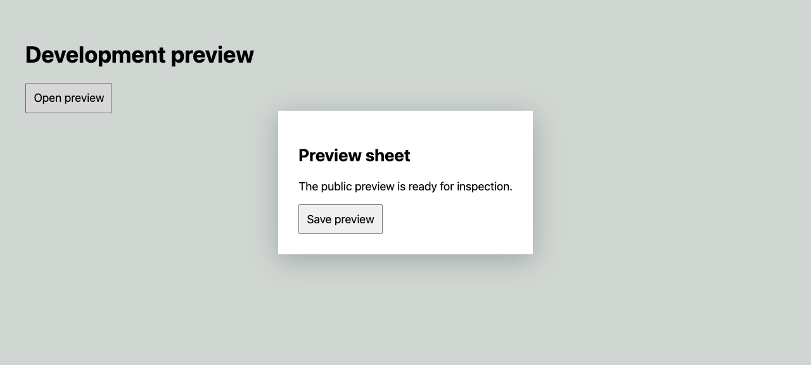

# Browser capture hardening (M3.1 Slice 1)

This record covers [issue #47](https://github.com/Schramm2/spyglass/issues/47).
It does not close the other M3.1 slices or release a new version.

## Public reproduction and limits

`fixtures/demo-app/server.mjs` serves `/proof-preview`: a modal sheet with a
finite entrance animation, a focused button, console and page errors, and a
health request. With `?stall=frames`, opening the sheet stops page animation
frame callbacks. The browser remains available for observations and screenshots.
This is a controlled public reproduction of a stalled frame wait, not proof
of the cause of any historical private-target timeout.

The screenshot-timeout checks use real Chromium for page actions, snapshots,
focus, console, errors and requests. An external `agent-browser` wrapper
withholds screenshot completion. It records whether diagnostics exist before
buffer clearing and counts screenshot attempts. It supplies no successful
observations or fabricated screenshot bytes. This checks a transport timeout,
not every possible Chromium rendering failure.

Before production changes, the sheet check failed after about 64.2 seconds.
The forced screenshot checks failed after about 62.7 seconds for `proof` and
92.5 seconds for `verify`: capture-stage metadata was absent. These are whole
E2E check durations, including setup and cleanup, not a general speed claim.
The first exploratory font-load fixture did not stall this browser's screenshot
path; it was removed in favor of the explicit transport timeout.

## Delivered behavior

- Snapshot and page diagnostics are retained before any buffer clear or image
  capture. Their artifact checksums remain available after a failed screenshot.
- Capture failures name `snapshot`, `diagnostics`, `buffer-clear`, `frame-settle`
  or `screenshot`, and retain stage outcomes and a capture-error artifact.
- A proof has a 20-second total capture budget per viewport, with a 10-second
  screenshot limit. Frame settling waits for two frames or 250 ms. A successful
  image still requires a successful screenshot command.
- `verify` does not attempt a second screenshot after proof capture fails.
  Failure capture after an action or expectation has a separate 5-second
  budget and a 2-second screenshot limit. Its own capture error is retained
  without replacing the original verification error.
- Failed proof does not link a visual claim. Explicitly citing the failed step
  is rejected by `result --check`. Cleanup and a diagnostic offline report
  remain available; a failed report never becomes complete.

Exact-origin isolation, run-owned browser sessions, source identity checks and
secret masking are unchanged. No private target was started or rechecked.
That repeat remains an explicit limit, not public acceptance evidence.

## Candidate and retained evidence

The candidate is based on `f34a91d`. These SHA-256 content hashes identify the
runtime and regression inputs checked after the review repairs:

| File                           | SHA-256                                                            |
| ------------------------------ | ------------------------------------------------------------------ |
| `src/browser.ts`               | `ac121644aa9bf5f4f991b4097996866c5bfcf998d28d55ec5317dc9a9b340a89` |
| `tests/e2e/surfaces.test.mjs`  | `ec20e6e7f245d4cf9b74acd3d8c06d44b477366d8b0d3e98cc70aac46ae02497` |
| `fixtures/demo-app/server.mjs` | `b84f4fe53a84aa4ea54f91703d637e5e434c04b67010e48823223622dfef9249` |

The focused browser checks passed after the review repairs (11 checks). An
independent read-only review then found no actionable defect. The first review
led to preserved recovery-stage output, capture-local proof failure assignment,
and an exact screenshot-attempt assertion. Its invalid-selector example did
not reproduce with the installed tool and is not counted as baseline proof.

The [overhead record](../bench/results/overhead-2026-11-07-m3.1-r1.json) passed
20 pairs on this candidate: added p50/p95 were 46.2/50.7 ms for `get title`,
47.5/77.2 ms for `expect`, and 60.5/80.5 ms for five actions with proof. Cold
start p50 was 27.5 ms. This is a local measurement, not a general speed claim
or resolution of the historical cloud overhead failure.

The retained [sheet image](../bench/results/m3.1-r1/sheet.png) has SHA-256
`5f639314a1fde6c5d4d1ee9c434a6c00a2979b3196b920645345df4938f4ef09`.
It contains public fixture content only.



## Repeat the checks

Use Node 24, `agent-browser` 0.38.2, Chromium and Docker as described in
[testing](../agent_docs/testing.md). Use a new artifact directory each time.

```sh
npm run build
SPYGLASS_TEST_SURFACES=1 SPYGLASS_TEST_ARTIFACTS=/tmp/spyglass-r1-proof \
  node --test --test-concurrency=1 \
  --test-name-pattern='sheet proof captures|screenshot timeout retains' \
  tests/e2e/surfaces.test.mjs
SPYGLASS_TEST_SURFACES=1 npm test
npm run format:check
node bench/overhead.mjs --pairs 20 --gate-cold --label r1-repeat
```

The focused checks retain `browser-capture/sheet.png` and the failed `proof`,
`verify` and `recovery` evidence folders, including their offline reports after
cleanup. Open the image before making an appearance claim. A reviewer opened
the local sheet image: the centered sheet, its heading, description and Save
preview button were visible with no clipped text at 1280 pixels wide. This
inspection covers only that image, not every browser state or viewport.

The required surface CI job retains these files with the existing artifact
upload. CI retention is bounded; see [CI](../agent_docs/ci.md). Local raw logs
and reports stay Git-ignored because they contain temporary machine paths.
The committed source and these commands make the checks repeatable; this page
is not a substitute for the actual reports or CI outcomes.
